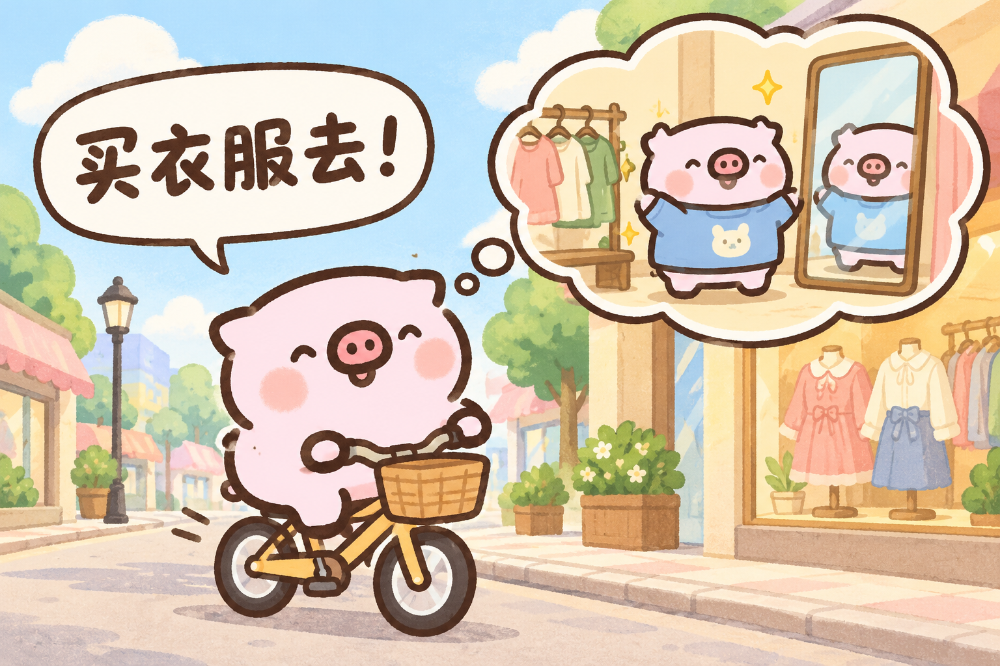

# 小猪在干嘛

把一句或几句聊天消息，画成同一只粉色小猪说出原话、配有对应表情、动作和场景的手绘漫画。

这是一个 **Codex Skill**，使用Codex内置生图工具。无需配置图像API Key；Python助手只整理任务和保存结果，不能单独运行生成图片。



固定09号原图锁定小猪的矮扁、头身一体比例，其他原图仅辅助动作。后续生成作品均不作为角色、画风或布局参考。“吃撑”等台词通过姿势和表情表达，不扩大腹围或脚掌，主角保持简洁浅粉平涂画法。

## 怎么用

安装后，在Codex消息框输入 `$piggy-activity`，选中「小猪在干嘛」，然后粘贴聊天原文。例如：

```text
$piggy-activity
我想买衣服了！
今天好开心～
```

不需要补写绘图提示词。技能会推断小猪的表情、动作和环境；有愿望或计划时可用想象气泡表现。台词保留原来的用词、标点、语气词和顺序，不替对方作答、不擅自总结。

每次生成后，Codex检查文字、角色及四肢，再保存PNG、实际提示词和任务记录。默认输出到当前项目的 `output/imagegen/`，也可以指定位置。

## 安装到Codex

在Codex使用 `$skill-installer`，提供本仓库的GitHub链接，并指定安装 `skills/piggy-activity` 目录。

也可以下载仓库，将 `skills/piggy-activity` 整个文件夹复制到你的个人Codex技能目录。本项目验证的位置为 `~/.codex/skills/piggy-activity`；其他宿主请使用其个人技能目录。安装后如果列表未更新，重新打开Codex。

便携包为 [小猪在干嘛.skill](dist/小猪在干嘛.skill)，它是ZIP格式，包含同样的技能文件。不是独立App，也不是模型权重；使用宿主提供的内置生图能力。

## 文件

```text
skills/piggy-activity/
  SKILL.md                       技能入口与生成流程
  agents/openai.yaml             显示名称和默认调用提示
  scripts/task.py                本地任务创建与保存助手
  assets/characters/             9张原始角色参考图
  references/                    角色索引与固定角色提示词
docs/
  example-bicycle.png            历史输出展示，不作为生图参考
dist/
  小猪在干嘛.skill               可携带的技能压缩包
```

角色以9张原图为准，场景随聊天原文变化。用户最初的聊天截图只在其本机技能中保留，辅助其中两幅漫画的配色和气泡布局；因包含私人对话，不随公开仓库或公开下载包分发。公开版本缺少这张图时只使用9张原图，不用生成图替代。这些是推理时的视觉参考，没有用于训练或微调模型。

## 运行说明

本地助手仅依赖Python 3.9及以上的标准库，命令说明：

```sh
python3 -B skills/piggy-activity/scripts/task.py --help
```

只有Codex内置生图步骤会调用图像生成服务，并传入台词、提示词和选中的参考图。保存助手没有网络调用。需要该宿主允许使用生图工具，使用额度以账号情况为准。

生成式图像仍可能出现错字、肢体异常或角色变化。技能要求目视检查，发现明显问题时针对该处修正一次；不能保证每张图片的文字和轮廓绝对准确。保存成功只表示文件已保存，不代表已通过自动OCR验收。
